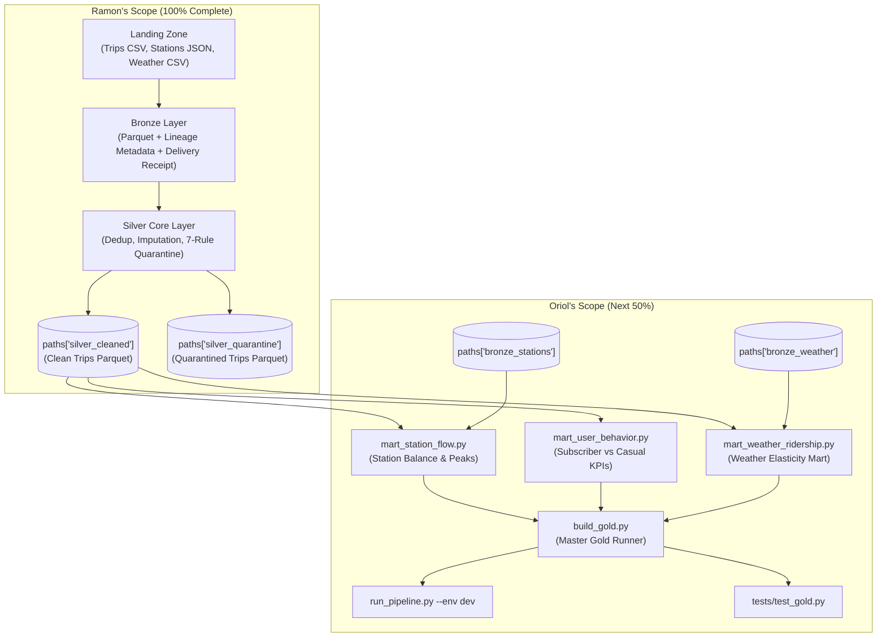

# DAT535 Data Engineering — Technical Handover Document

> **Project:** CityBikes & NOAA Weather Scalable Medallion Architecture Pipeline  
> **Author:** Ramon Garcia Arrasa (`ragar6064@uis.no`)  
> **Assignee:** Oriol Garcia Torcal  
> **Date:** November 2026  
> **Target Branch:** `dev`  
> **Repository:** `roarkg05-svg/group3`  
> **Active CI Runner:** `spark-group03` (`152.94.163.180`)

---

## Table of Contents

1. [Executive Summary & Current Architecture State](#1-executive-summary--current-architecture-state)
2. [Critical Environment Rules (Must-Read Before Coding)](#2-critical-environment-rules-must-read-before-coding)
3. [Silver Layer Output Contract (What Oriol Ingests)](#3-silver-layer-output-contract-what-oriol-ingests)
4. [Step-by-Step Deliverables for Oriol (His 50%)](#4-step-by-step-deliverables-for-oriol-his-50)
   - [Task 1: Build the Gold Analytical Marts (`src/gold/`)](#task-1-build-the-gold-analytical-marts-srcgold)
   - [Task 2: Integrate Gold into `run_pipeline.py`](#task-2-integrate-gold-into-run_pipelinepy)
   - [Task 3: Build the Gold Unit & Integration Tests (`tests/test_gold.py`)](#task-3-build-the-gold-unit--integration-tests-teststest_goldpy)
   - [Task 4: Local & CI Verification Commands](#task-4-local--ci-verification-commands)
   - [Task 5: Pull Request & Production Deployment](#task-5-pull-request--production-deployment)
5. [Handover Checklist for Oriol](#5-handover-checklist-for-oriol)

---

## 1. Executive Summary & Current Architecture State

Welcome Oriol! The first 50% of the project (Bronze Ingestion, Silver Core Cleaning, Coordinate Imputation, 7-Rule Quarantine Engine, and CI/CD Automation) is completed, tested, and validated on the Ubuntu runner.

### Completed Components (Ramon's 50%)

1. **Bronze Ingestion Layer ([`src/bronze/ingest_bronze.py`](src/bronze/ingest_bronze.py)):**
   - Implements *"Load First, Interpret Later"* & *"Payload Plus Evidence"*.
   - Reads raw multi-file CSV and JSON batches (`trips`, `stations`, `weather`) preserving raw payload fidelity.
   - Appends mandatory metadata audit columns: `_source_file`, `_dataset_type`, `_ingestion_timestamp`, `_run_id`, `_schema_version`.
   - Persists tables as Snappy-compressed Parquet in `paths["bronze_*"]`.
   - Generates a cryptographically sound JSON delivery receipt ([`_delivery_receipt.json`](config/settings.py#L39)) verifying file counts, row counts, and schema validation.

2. **Silver Core Layer ([`src/silver/clean_quarantine.py`](src/silver/clean_quarantine.py)):**
   - **Method 1 (Shape & Physics):** Trims strings, normalizes empty strings `""` and `"0.0"` to `NULL`, imputes missing end coordinates (`end_lat`, `end_lng`) using `end_station_id` looked up against the GBFS station catalog, and computes Haversine distance ($d_{\text{km}}$) and velocity ($v_{\text{km/h}}$).
   - **Method 2 (Identity & Deduplication):** Enforces transaction grain uniqueness on `ride_id` partitioned by window ordered by `_ingestion_timestamp DESC, _source_file DESC`.
   - **Method 3 (Trust & 7-Rule Quarantine Engine):** Employs the *"Flag, Don't Delete"* paradigm. Anomalous trips are routed to `silver_quarantine` with descriptive `dq_issue` and multi-rule `_rejection_reason` tags:
     - `MISSING_CRITICAL_KEY`
     - `NEGATIVE_OR_ZERO_DURATION`
     - `FALSE_UNLOCK_UNDER_60S`
     - `LOST_OR_STOLEN_OVER_24H`
     - `CIRCULAR_ABANDONED_TRIP`
     - `IMPOSSIBLE_PHYSICAL_SPEED` (>45 km/h classic, >55 km/h electric)
     - `OUT_OF_NYC_BOUNDS`
   - Emits a clean dataset to `paths["silver_cleaned"]` and an audit report to `paths["silver_quality_report"]`.

3. **CI/CD & Runner Automation ([`.github/workflows/dat535-dev.yml`](.github/workflows/dat535-dev.yml)):**
   - Self-hosted GitHub Actions runner `spark-group03` automatically triggers on push to `dev`.
   - Executes Pytest integration tests and dev pipeline runs.
   - Publishes automated markdown summaries directly to GitHub Actions Step Summary.



---

## 2. Critical Environment Rules (Must-Read Before Coding)

> [!CAUTION]
> **READ CAREFULLY!** Failure to set these environment variables on the VM (`spark-group03`) will cause Spark or Pytest to fail immediately.

When SSH-ing into the runner VM (`ssh ubuntu@152.94.163.180`), run these commands **before executing any Python or Pytest script**:

```bash
# 1. Activate the designated runner virtual environment (Python 3.11+)
source /home/ubuntu/spark-env/bin/activate

# 2. CRITICAL: ALWAYS unset SPARK_HOME!
# The VM has an old Spark 3.x in /opt/spark. If SPARK_HOME is set to /opt/spark,
# PySpark 4.2.0 will try to load old JARs and fail with:
# "TypeError: 'JavaPackage' object is not callable".
unset SPARK_HOME

# 3. CRITICAL: ALWAYS enforce Java 17!
# PySpark 4.2.0 requires Java 17 (Class File Version 61.0).
# The VM's default Java 8 (1.8.0_502, Version 52.0) will cause:
# "UnsupportedClassVersionError: class file version 61.0 vs 52.0".
export JAVA_HOME="/usr/lib/jvm/java-17-openjdk-amd64"
export PATH="$JAVA_HOME/bin:/home/ubuntu/spark-env/bin:$PATH"

# 4. Set PYTHONPATH to the repository root
export PYTHONPATH="$(pwd)"

# 5. Quick sanity check
python --version   # Must show Python 3.11.x or 3.12.x
java -version     # Must show OpenJDK 17.0.x
```

---

## 3. Silver Layer Output Contract (What Oriol Ingests)

Oriol, your Gold layer consumes the pristine datasets written to disk by the Silver layer. Use [`config/settings.py`](config/settings.py) to resolve the exact paths for any environment (`dev`, `test`, `prod`):

```python
from config.settings import get_env_paths

paths = get_env_paths(env="dev")
# Cleaned trips: paths["silver_cleaned"]
# Stations catalog: paths["bronze_stations"]
# NOAA weather: paths["bronze_weather"]
```

### Table 1: Cleaned Trips (`paths["silver_cleaned"]`)
Parquet dataset containing all valid, deduplicated, coordinate-imputed trips with physics telemetry:

| Column Name | Spark Data Type | Description |
|---|---|---|
| `ride_id` | `StringType` | Unique trip identifier (Primary Key) |
| `bike_id` | `StringType` | Unique identifier of the bicycle |
| `rideable_type` | `StringType` | `classic_bike` or `electric_bike` |
| `started_at` | `TimestampType` | UTC trip unlock timestamp |
| `ended_at` | `TimestampType` | UTC trip dock timestamp |
| `start_station_id` | `StringType` | Origin station identifier (FK $\rightarrow$ stations) |
| `end_station_id` | `StringType` | Destination station identifier (FK $\rightarrow$ stations) |
| `start_lat` | `DoubleType` | Origin latitude |
| `start_lng` | `DoubleType` | Origin longitude |
| `end_lat` | `DoubleType` | Destination latitude (imputed from station catalog if missing) |
| `end_lng` | `DoubleType` | Destination longitude (imputed from station catalog if missing) |
| `member_casual` | `StringType` | User tier: `member` (subscriber) or `casual` (pay-per-ride) |
| `trip_duration_min` | `DoubleType` | Computed duration in decimal minutes |
| `distance_km` | `DoubleType` | Great-circle Haversine distance in kilometers |
| `speed_kmh` | `DoubleType` | Computed velocity in km/h ($d / t$) |
| `_coord_imputed` | `BooleanType` | `True` if end coordinates were imputed, `False` otherwise |
| `dq_handling_flag` | `StringType` | `"IMPUTED_END_COORDS"` or `"ORIGINAL_COORDS"` |
| `_source_file` | `StringType` | Source landing file lineage |
| `_ingestion_timestamp` | `TimestampType` | Lineage audit timestamp |
| `_run_id` | `StringType` | Execution identifier |
| `_schema_version` | `StringType` | Contract tag (`v1.0`) |

### Table 2: Stations Catalog (`paths["bronze_stations"]`)
Parquet dataset containing GBFS dock infrastructure:

| Column Name | Spark Data Type | Description |
|---|---|---|
| `station_id` | `StringType` | Unique station identifier (`ST_0001`, etc.) |
| `station_name` | `StringType` | Street address / intersection name |
| `capacity` | `LongType` | Total physical bike dock count (15–60 docks) |
| `region_id` | `StringType` | Borough / Neighborhood sector (e.g. `MANHATTAN_MIDTOWN`) |
| `station_lat` | `DoubleType` | GPS latitude |
| `station_lng` | `DoubleType` | GPS longitude |
| `is_active` | `BooleanType` | Operating status flag |

### Table 3: NOAA Hourly Weather (`paths["bronze_weather"]`)
Parquet dataset containing hourly meteorological observations:

| Column Name | Spark Data Type | Description |
|---|---|---|
| `weather_timestamp` | `StringType` | Timestamp string (`YYYY-MM-DD HH:MM:SS`) |
| `temp_c` | `DoubleType` | Ambient air temperature in Celsius |
| `precipitation_mm` | `DoubleType` | Hourly rainfall accumulation in mm |
| `wind_kmh` | `DoubleType` | Wind speed in km/h |
| `condition` | `StringType` | `Clear`, `Partly Cloudy`, `Cloudy`, `Light Rain`, `Heavy Rain` |

---

## 4. Step-by-Step Deliverables for Oriol (His 50%)

### Task 1: Build the Gold Analytical Marts (`src/gold/`)

Create modular, production-grade PySpark modules in `src/gold/`:

```text
src/gold/
├── __init__.py                     # Package export
├── mart_station_flow.py            # Mart 1: Station traffic balance & peak hours
├── mart_user_behavior.py           # Mart 2: Subscriber vs casual dynamics & routes
├── mart_weather_ridership.py       # Mart 3: Weather elasticity correlation
└── build_gold.py                   # Master Gold orchestrator
```

#### 1. `src/gold/mart_station_flow.py`
- **Objective:** Compute daily station demand balance and traffic pressure to support physical bike rebalancing logistics.
- **Transformations:**
  1. Extract `trip_date` (`to_date(started_at)`).
  2. Aggregate departures per station (`groupBy("start_station_id", "trip_date")`).
  3. Aggregate arrivals per station (`groupBy("end_station_id", "trip_date")`).
  4. Full outer join on station ID and date.
  5. Join station catalog to retrieve `station_name`, `capacity`, and `region_id`.
  6. Calculate `net_flow = inbound_trips - outbound_trips`.
  7. Compute turnover ratio: $\text{turnover} = \frac{\text{inbound} + \text{outbound}}{\text{capacity}}$.
  8. Identify peak departure hour for each station using window ranking (`dense_rank()` over `count` ordered desc).
- **Target Path:** `paths["gold_rebalancing"]` partitioned by `year` and `month`.

#### 2. `src/gold/mart_user_behavior.py`
- **Objective:** Compare behavioral profiles of annual subscribers (`member`) versus walk-up riders (`casual`).
- **Transformations:**
  1. Group by `member_casual` and `rideable_type`.
  2. Calculate `total_trips`, `avg_duration_min`, `median_duration_min` (using `percentile_approx(trip_duration_min, 0.5)`), `avg_speed_kmh`, `avg_distance_km`.
  3. Identify Top 10 Popular Corridors:
     - Group by `start_station_name` and `end_station_name`.
     - Rank top 10 routes by volume for members and casual riders separately.
- **Target Path:** `paths["gold_rebalancing"].replace("station_rebalancing_mart", "user_behavior_mart")`.

#### 3. `src/gold/mart_weather_ridership.py`
- **Objective:** Analyze how meteorological conditions influence rider velocity and trip volume.
- **Transformations:**
  1. Truncate `started_at` to the hour: `date_trunc("hour", started_at)`.
  2. Parse `weather_timestamp` in weather table to timestamp and truncate to hour.
  3. Join clean trips with weather on hourly timestamp (`how="inner"`).
  4. Categorize conditions:
     - Temperature bins: `Freezing (<0°C)`, `Cold (0-10°C)`, `Mild (10-20°C)`, `Warm (>20°C)`.
     - Rain bins: `No Rain (0.0mm)`, `Light Rain (0.1-5.0mm)`, `Heavy Rain (>5.0mm)`.
  5. Aggregate hourly trip volume, average distance, and average speed per weather bin.
- **Target Path:** `paths["gold_weather_impact"]`.

#### 4. `src/gold/build_gold.py`
- **Objective:** Master orchestrator for the Gold layer.
- **Interface:**
  ```python
  def run_gold_transformation(spark: SparkSession, env: str, run_id: str) -> Dict[str, Any]:
      """Execute all Gold marts and write a JSON summary signal."""
  ```
- **Requirements:**
  - Persist all Parquet tables in overwrite mode.
  - Return a dictionary summarizing row counts and metrics for each mart.
  - Write a ready signal file: `paths["gold_ready_signal"]` (`_READY_SIGNAL.json`).

---

### Task 2: Integrate Gold into `run_pipeline.py`

Update [`run_pipeline.py`](run_pipeline.py) so that executing `python run_pipeline.py --env dev` runs the full end-to-end Medallion pipeline:

1. Import `run_gold_transformation` from `src.gold.build_gold`.
2. Call it directly after `run_silver_cleaning(spark, env, run_id)`.
3. Include Gold metrics in the terminal log and the `GITHUB_STEP_SUMMARY` table:
   ```markdown
   ### Gold Marts Summary
   - Station Rebalancing Records: `...`
   - User Behavior Records: `...`
   - Weather Ridership Records: `...`
   ```

---

### Task 3: Build the Gold Unit & Integration Tests (`tests/test_gold.py`)

Create [`tests/test_gold.py`](tests/test_gold.py) using Pytest to guarantee regression prevention:

1. **`test_station_flow_conservation()`**:
   - Verify that total system departures equals total system arrivals across all station rows.
   - Assert `net_flow == inbound_trips - outbound_trips`.
   - Assert `turnover_ratio >= 0.0`.
2. **`test_weather_join_integrity()`**:
   - Assert that joining trips with weather does **not** cause row Cartesian multiplication.
   - Verify all temperature and precipitation bins are non-null.
3. **`test_user_behavior_kpis()`**:
   - Verify that member average durations and speeds fall within realistic physical limits.
   - Ensure the Top 10 routes table contains exactly 10 routes (or fewer if total unique corridors < 10).
4. **`test_gold_parquet_artifacts_exist()`**:
   - Assert all Gold Parquet folders exist on disk and contain valid Parquet files.
   - Verify `_READY_SIGNAL.json` exists and contains `{"status": "SUCCESS"}`.

---

### Task 4: Local & CI Verification Commands

Oriol, run these commands in sequence to verify your implementation:

```bash
# 1. Run only Gold unit tests
python -m pytest tests/test_gold.py -v

# 2. Run the entire test suite (Bronze, Silver Core, and Gold)
python -m pytest tests/ -v

# 3. Run the full Medallion pipeline locally in dev mode
python run_pipeline.py --env dev
```

---

### Task 5: Pull Request & Production Deployment

Once all tests pass locally:

1. Stage and commit your changes:
   ```bash
   git add src/gold/ tests/test_gold.py run_pipeline.py
   git commit -m "feat(gold): implement station flow, user behavior, and weather marts with tests"
   git push origin dev
   ```
2. Check GitHub Actions: Navigate to GitHub $\rightarrow$ **Actions** $\rightarrow$ verify that `DAT535 Dev Medallion CI` finishes with a green checkmark (`✔`).
3. Open a Pull Request from `dev` to `main`:
   - Title: `Release: Full Medallion Pipeline (Bronze, Silver, Gold)`
   - Tag Ramon as reviewer.
   - Once approved, merge into `main` to trigger the production deployment workflow ([`dat535-prod.yml`](.github/workflows/dat535-prod.yml)).

---

## 5. Handover Checklist for Oriol

Track your progress using this checklist:

- [ ] **Step 1: Environment Readiness**
  - [ ] Logged into `spark-group03` via SSH.
  - [ ] Sourced `/home/ubuntu/spark-env/bin/activate`.
  - [ ] Unset `SPARK_HOME` and verified Java 17 (`export JAVA_HOME="/usr/lib/jvm/java-17-openjdk-amd64"`).
- [ ] **Step 2: Gold Analytical Marts**
  - [x] Implemented `src/gold/mart_station_flow.py` (Station net balance & peak hours).
  - [x] Implemented `src/gold/mart_user_behavior.py` (Subscriber vs casual & top 10 corridors).
  - [x] Implemented `src/gold/mart_weather_ridership.py` (Hourly weather correlation & bins).
  - [x] Implemented `src/gold/build_gold.py` (`run_gold_transformation` orchestrator).
- [ ] **Step 3: Pipeline Integration**
  - [x] Integrated `run_gold_transformation` into `run_pipeline.py`.
  - [x] Tested `python run_pipeline.py --env dev` end-to-end without errors.
- [ ] **Step 4: Automated Testing**
  - [x] Created `tests/test_gold.py`.
  - [x] Passed `python -m pytest tests/test_gold.py -v`.
  - [x] Passed `python -m pytest tests/ -v` (all tests green).
- [ ] **Step 5: Release & Delivery**
  - [x] Pushed commits to branch `dev`.
  - [x] Verified green build on GitHub Actions runner `spark-group03`.
  - [ ] Opened Pull Request from `dev` to `main`.
