# DAT535 Data Engineering — NYC Citi Bike & NOAA Weather Medallion Pipeline

[](https://github.com/roarkg05-svg/group3/actions/workflows/dat535-dev.yml)
[](https://www.python.org/)
[](https://spark.apache.org/)
[](https://openjdk.org/projects/jdk/17/)

## Project & Team Identification

- **Course:** DAT535 — Data Engineering (University of Stavanger, Autumn 2026)
- **Group:** Group 03 (`spark-group03`)
- **Repository:** [`roarkg05-svg/group3`](https://github.com/roarkg05-svg/group3)
- **Branch Strategy:** Active development & automated CI on `dev` $\rightarrow$ Pull Request review $\rightarrow$ Merge to `main` for production deployment.

### Team Members & Ownership

| Name | UiS ID / Email | GitHub Handle | Primary Responsibilities |
| :--- | :--- | :--- | :--- |
| **Ramon Garcia Arrasa** | `309024` (`ragar6064@uis.no`) | `@roarkg05-svg` | Project Architecture, Deterministic Data Generator, Bronze Layer Ingestion & Lineage, Silver Layer (Deduplication, Coordinate Imputation, 7-Rule Quarantine Engine, Station & Calendar Conformance), Dev CI/CD & VM Runner Setup |
| **Oriol Garcia Torcal** | `309023` (`ogtorcal@gmail.com`) | `@origar10` | Gold Layer Analytical Marts (Station Flow, User Behavior, Weather Ridership), Silver-to-Gold Reconciliation & `_READY_SIGNAL.json`, Gold Test Suite & Production Workflows (`dat535-prod.yml`) |

---

## Table of Contents

1. [Project Statement & Scope](#1-project-statement--scope)
2. [Dataset — Source & Suitability](#2-dataset--source--suitability)
3. [Bronze Layer — Ingest & Preserve](#3-bronze-layer--ingest--preserve)
4. [Silver Layer — Primary Focus (Clean, Impute, Deduplicate & Quarantine)](#4-silver-layer--primary-focus-clean-impute-deduplicate--quarantine)
5. [Gold Layer — Serve the Outcome](#5-gold-layer--serve-the-outcome)
6. [End-to-End Delivery — Operate the Lifecycle](#6-end-to-end-delivery--operate-the-lifecycle)
7. [Evidence & Engineering Reflection](#7-evidence--engineering-reflection)
8. [Repository Structure & Archived Coursework (`labs/`)](#8-repository-structure--archived-coursework-labs)

---

## 1. Project Statement & Scope

### What It Builds
This project implements an automated, fault-tolerant **Medallion Architecture (`Bronze` $\rightarrow$ `Silver` $\rightarrow$ `Gold`)** data engineering pipeline built with **Apache Spark (PySpark 4.2.0)** and deployed on a dedicated self-hosted Linux runner (`spark-group03`). The pipeline ingests multi-batch urban bikeshare ride telemetry alongside station infrastructure feeds and hourly meteorological observations, enforces data quality contracts through a **7-rule quarantine engine**, and publishes reconciled analytical marts.

### Analytical Need
Urban bikeshare operators face three core operational and analytical challenges:
1. **Fleet Rebalancing Logistics:** Commuter rushes drain residential origin docks in the morning and saturate commercial district docks, requiring daily station-level net-flow and turnover metrics.
2. **Rider Segmentation & Corridor Planning:** Annual subscribers (`member`) and walk-up riders (`casual`) exhibit distinct trip durations, velocities, e-bike adoption rates, and origin-destination corridors.
3. **Weather Elasticity:** Precipitation and temperature shifts strongly impact hourly trip volume and average riding speed.

### Bounded Outcome
A reproducible batch pipeline (`run_pipeline.py`) that transforms raw landing files into four verified Gold Parquet marts gated by an automated Silver-to-Gold reconciliation signal (`_READY_SIGNAL.json`), backed by 11 unit and integration tests and continuous delivery workflows across `dev` and `prod` environments.

### Out of Scope
- Sub-second real-time Kafka/Spark Structured Streaming dock telemetry ingestion.
- Predictive machine learning demand forecasting or dynamic pricing models.
- External BI dashboard hosting (e.g., Tableau/PowerBI web servers); consumption stops at verified Gold Parquet marts and console/CI summary tables.

```mermaid
flowchart LR
    subgraph Raw["Landing Zone (Raw Batches)"]
        R1["citibike_*.csv<br/>(Trips Batches)"]
        R2["gbfs_stations.json<br/>(GBFS Station Catalog)"]
        R3["noaa_hourly_weather.csv<br/>(Hourly Weather)"]
    end

    subgraph Bronze["Bronze Layer (Ingest & Preserve)"]
        B1[("bronze/trips<br/>(Parquet + Lineage)")]
        B2[("bronze/stations<br/>(Parquet + Lineage)")]
        B3[("bronze/weather<br/>(Parquet + Lineage)")]
        BR["bronze_receipt.json<br/>(Delivery Audit)"]
    end

    subgraph Silver["Silver Layer (Clean, Impute & Quarantine)"]
        SC[("silver/trips<br/>(31,325 Clean Rows)")]
        SE[("silver/trips_enriched<br/>(Station & Calendar Conformed)")]
        SQ[("silver/quarantine/trips<br/>(3,150 Quarantined Rows)")]
        SR["silver_quality_report.json<br/>(Before vs After Evidence)"]
    end

    subgraph Gold["Gold Layer (Serve the Outcome)"]
        G1[("station_rebalancing_mart<br/>(Daily Net Flow & Turnover)")]
        G2[("user_behavior_mart/kpis<br/>(Member vs Casual KPIs)")]
        G3[("user_behavior_mart/top_corridors<br/>(Top 10 Routes per Tier)")]
        G4[("weather_commute_impact<br/>(Ridership by Temp & Rain Bins)")]
        GS["_READY_SIGNAL.json<br/>(Reconciliation Gate)"]
    end

    Raw -->|Source-Faithful Ingest + Audit Metadata| Bronze
    Bronze -->|Dedup, Impute Coords & 7-Rule Quarantine| Silver
    Silver -->|Aggregate, Reconcile & Publish| Gold
```



---

## 2. Dataset — Source & Suitability

### Multi-Source Data Architecture
The pipeline integrates three complementary datasets modeled directly on the **NYC Citi Bike / Lyft System Data**, **General Bikeshare Feed Specification (GBFS)**, and **NOAA Hourly Climate Normals**:

| Dataset | Format | Synthetic Volume (`--source synthetic`) | Real S3/API Volume (`--source real`) | Primary Join Keys |
| :--- | :--- | :--- | :--- | :--- |
| **1. Ride Transactions (`trips`)** | Multi-batch CSV (`2` files) | `35,000` rows (`17,237` + `17,763`) | `115,558` rows (JC) / `~3.5M` (NYC) | `ride_id` (PK), `start_station_id`, `end_station_id`, `started_at` |
| **2. Station Catalog (`stations`)** | Multi-line JSON (`1` file) | `120` NYC docking stations | `4,700+` live GBFS stations | `station_id` (PK) |
| **3. Hourly Weather (`weather`)** | CSV (`1` file) | `240` hourly observations (`10` days) | `720` hourly observations (`1` month) | `weather_timestamp` (truncated to hour) |

### Inherent Schema & Data Quality Risks
Raw bikeshare and weather feeds exhibit real-world operational defects that make naive aggregation dangerous:
- **Multi-Batch Duplicate Deliveries:** Overlapping batch exports re-emit identical `ride_id` records across files (`1.5%` / `525` rows).
- **Missing or Zeroed Destination GPS Coordinates:** Dock communication dropouts frequently record `end_lat` / `end_lng` as empty strings `""` or `(0.0, 0.0)` (`3.0%` / `1,050` rows) even when `end_station_id` is valid.
- **Missing Critical Identifiers:** Corrupt records lacking `ride_id`, `started_at`, `ended_at`, `start_station_id`, or `end_station_id` (`1.2%` / `420` rows).
- **Clock Skew & Negative/Zero Durations:** Unsynchronized dock clocks producing `ended_at <= started_at` (`1.2%` / `420` rows).
- **False Unlocks (`< 60s`):** Riders immediately re-docking a defective bike within 60 seconds (`1.4%` / `490` rows).
- **Lost or Stolen Bikes (`> 24h`):** Trips exceeding `1,440` minutes (`1.1%` / `385` rows).
- **Circular Abandoned Unlocks:** Same origin and destination station with duration `< 3` minutes and displacement `< 0.05` km (`1.3%` / `455` rows).
- **Impossible Physical Speeds:** GPS multipath errors or bikes transported in vans exceeding `45 km/h` (classic) or `55 km/h` (electric) (`1.4%` / `490` rows).
- **Out-of-Bounds Coordinates:** Stray telemetry falling outside the NYC metropolitan bounding box (`lat` $\notin [40.45, 40.95]$ or `lng` $\notin [-74.30, -73.65]$) (`1.4%` / `490` rows).
- **Orphan Station Identifiers:** Newly deployed or temporary pop-up docks (`ST_9901`–`ST_9905`, `1.5%` / `525` rows) appearing in trip logs before registration in the GBFS station catalog.

### Dual Execution Modes
- **Deterministic Synthetic Mode (`--source synthetic`, Default):** Implemented in [`src/utils/data_generator.py`](src/utils/data_generator.py) (`seed=42`). Guarantees offline reproducibility in CI/CD while deterministically exercising every single imputation branch, deduplication window, orphan station join, and all 7 quarantine rules.
- **Live Cloud Ingestion Mode (`--source real`):** Implemented in [`src/utils/real_data_downloader.py`](src/utils/real_data_downloader.py). Fetches official Citi Bike `.csv.zip` archives from Amazon S3, live station JSON from the NYC GBFS API, and historical weather from the Open-Meteo NOAA archive.

---

## 3. Bronze Layer — Ingest & Preserve

- **Implementation:** [`src/bronze/ingest_bronze.py`](src/bronze/ingest_bronze.py)
- **Design Principles:** *"Load First, Interpret Later"* and *"Payload Plus Evidence"*.

### Source-Faithful Ingestion & Lineage Metadata
The Bronze layer reads raw landing CSV and JSON batches without dropping malformed records or performing destructive type casting. Every record across `bronze/trips`, `bronze/stations`, and `bronze/weather` is enriched with five mandatory lineage columns before being written as Snappy-compressed Parquet:

| Lineage Column | Type | Purpose |
| :--- | :--- | :--- |
| `_source_file` | `StringType` | Exact physical file path captured via Spark `F.input_file_name()` |
| `_dataset_type` | `StringType` | Domain tag (`trips`, `stations`, or `weather`) |
| `_ingestion_timestamp` | `TimestampType` | UTC execution timestamp via `F.current_timestamp()` |
| `_run_id` | `StringType` | Pipeline execution identifier (e.g., `pipeline_prod_20261110_234000`) |
| `_schema_version` | `StringType` | Contract version tag (`v1.0`) |

### Delivery Audit Receipt (`bronze_receipt.json`)
At the conclusion of Bronze ingestion, the pipeline verifies expected batch file counts (`4` files across `trips`, `stations`, and `weather`), validates that all required source and metadata columns are present, and writes [`bronze/bronze_receipt.json`](src/bronze/ingest_bronze.py) (alongside `_delivery_receipt.json` for backward compatibility) recording `"status": "SUCCESS"`, `"schema_validation_status": "PASSED"`, and exact persisted row counts.

---

## 4. Silver Layer — Primary Focus (Clean, Impute, Deduplicate & Quarantine)

- **Implementation:** [`src/silver/clean_quarantine.py`](src/silver/clean_quarantine.py) and [`src/silver/enrich_conform.py`](src/silver/enrich_conform.py)
- **Target Grain:** Exactly **one row per unique, validated bicycle ride transaction (`ride_id`)**.

### Method 1: Shape Normalization, Coordinate Imputation & Haversine Physics
1. **String & Coordinate Normalization:** Trims whitespace across all string fields, normalizes empty strings `""` to `NULL`, and uses ANSI-safe `try_cast(trim(col) AS double)` to convert coordinates while mapping `0.0` placeholder coordinates to `NULL`.
2. **GBFS Station Coordinate Imputation:** Performs a broadcast left join (`F.broadcast`) against the deduplicated GBFS station catalog on `end_station_id`. When `end_lat` or `end_lng` is `NULL` (or `0.0`) but the destination station exists in the catalog, the pipeline imputes the authoritative station coordinates and sets `_coord_imputed = True` and `dq_handling_flag = "IMPUTED_END_COORDS"` (`1,050` trips rescued per run).
3. **Great-Circle Haversine Physics:** Computes trip duration in minutes (`trip_duration_min`), Haversine distance in kilometers (`distance_km`), and physical velocity (`speed_kmh`):
   $$d = 2 R \arcsin \left(\sqrt{\sin^2\left(\frac{\Delta \phi}{2}\right) + \cos(\phi_1)\cos(\phi_2)\sin^2\left(\frac{\Delta \lambda}{2}\right)}\right), \quad R = 6371.0\text{ km}$$

### Method 2: Primary Key Window Deduplication
To eliminate duplicate records across overlapping batch files without accidentally collapsing corrupt rows that have `ride_id IS NULL`, the pipeline constructs a synthetic partition key (`__NULL_RIDE_<monotonically_increasing_id>` when `ride_id` is null) and applies a deterministic window:
```python
dedup_window = Window.partitionBy(partition_ride_key).orderBy(
    F.col("_ingestion_timestamp").desc(), F.col("_source_file").desc()
)
```
Retaining `_rn == 1` removes exactly `525` duplicate `ride_id` records while preserving all null-key records so they are properly audited by Quarantine Rule 1.

### Method 3: Autonomous 7-Rule Quarantine Engine (*"Flag, Don't Delete"*)
Every deduplicated record is evaluated against all seven domain rules simultaneously. Records violating one or more rules are routed to `silver/quarantine/trips` with both a primary `dq_issue` classification and a comma-delimited `_rejection_reason` string capturing multi-rule violations:

| Rule # | Rule Code (`dq_issue`) | Quarantine Condition | Quarantined Rows (`35k` Run) |
| :---: | :--- | :--- | :---: |
| **1** | `MISSING_CRITICAL_KEY` | `ride_id`, `started_at`, `ended_at`, `start_station_id`, or `end_station_id` is `NULL` | `420` |
| **2** | `NEGATIVE_OR_ZERO_DURATION` | `trip_duration_min <= 0.0` | `420` |
| **3** | `FALSE_UNLOCK_UNDER_60S` | `0.0 < trip_duration_min < 1.0` | `490` |
| **4** | `LOST_OR_STOLEN_OVER_24H` | `trip_duration_min > 1440.0` (24 hours) | `385` |
| **5** | `CIRCULAR_ABANDONED_TRIP` | `start_station_id == end_station_id` AND `duration < 3.0m` AND `distance_km < 0.05` | `455` |
| **6** | `IMPOSSIBLE_PHYSICAL_SPEED` | Classic bike `> 45.0 km/h` OR Electric bike `> 55.0 km/h` | `490` |
| **7** | `OUT_OF_NYC_BOUNDS` | Coordinate `NULL` or outside $\text{Lat } [40.45, 40.95]$, $\text{Lng } [-74.30, -73.65]$ | `490` |
| — | **Total Quarantined** | **All 7 Rules Combined (9.14% of deduplicated rows; gate $\le$ 25.0%)** | **`3,150`** |

### Strict Row Conservation Equation
$$\underbrace{35,000}_{\text{Bronze Input Rows}} = \underbrace{31,325}_{\text{Silver Clean Rows (89.50\%)}} + \underbrace{3,150}_{\text{Silver Quarantined Rows (9.00\%)}} + \underbrace{525}_{\text{Duplicates Removed (1.50\%)}}$$

### Method 4: Station Dimension & Calendar Conformance (`enrich_conform.py`)
[`src/silver/enrich_conform.py`](src/silver/enrich_conform.py) enriches the `31,325` clean trips by broadcasting the deduplicated GBFS station dimension table (`station_name`, `region_id`, `capacity`) across both `start_station_id` and `end_station_id`, deriving calendar attributes (`trip_date`, `hour_of_day`, `day_of_week`, `is_weekend`) and catalog presence flags (`is_start_catalog_station`, `is_end_catalog_station`), and writing the conformed dataset to `silver/trips_enriched`.

### Spark Performance & Partitioning Choices
- **Adaptive Query Execution (`spark.sql.adaptive.enabled = true`):** Dynamically coalesces post-shuffle partitions and optimizes join strategies at runtime.
- **Tuned Shuffle Parallelism (`spark.sql.shuffle.partitions = 8`):** Sized to match the local/VM CPU core topology, avoiding the 200-partition small-file overhead of Spark's default setting.
- **Broadcast Hash Joins (`F.broadcast`):** Applied to station coordinate lookups (`120` rows), station dimension joins, and hourly weather joins (`240` rows) to eliminate expensive sort-merge network shuffles of the trip fact table.
- **UTC Timezone Standardization (`spark.sql.session.timeZone = UTC`):** Prevents daylight-saving and host-locale drift during timestamp parsing and hourly truncation.

---

## 5. Gold Layer — Serve the Outcome

- **Implementation:** [`src/gold/`](src/gold/) (`mart_station_flow.py`, `mart_user_behavior.py`, `mart_weather_ridership.py`, orchestrated by `build_gold.py`)

### Business Mart Specifications

| Mart Module | Target Parquet Path | Grain | Key Metrics & Engineering Logic |
| :--- | :--- | :--- | :--- |
| **[`mart_station_flow.py`](src/gold/mart_station_flow.py)** | `gold/station_rebalancing_mart` *(partitioned by `year`, `month`)* | `station_id` $\times$ `trip_date` (`894` rows) | Full outer join of daily departures (`started_at` date) and arrivals (`ended_at` date) so overnight trips credit stock on the exact calendar day; computes `net_flow = inbound - outbound`, `turnover_ratio = (inbound + outbound) / capacity`, and deterministic `peak_departure_hour` via `row_number()` tie-breaking. Preserves non-catalog orphan stations (`is_catalog_station = False`, `turnover_ratio = NULL`). |
| **[`mart_user_behavior.py`](src/gold/mart_user_behavior.py)** | `gold/user_behavior_mart/kpis` & `gold/user_behavior_mart/top_corridors` | `member_casual` $\times$ `rideable_type` (`4` rows) & Top `10` corridors per tier (`20` rows) | Computes `total_trips`, `avg_duration_min`, `median_duration_min` (`percentile_approx(..., 0.5)`), `avg_speed_kmh`, and `avg_distance_km`. Ranks the top 10 origin-destination station pairs per rider tier with fallback to `station_id` for uncataloged docks. |
| **[`mart_weather_ridership.py`](src/gold/mart_weather_ridership.py)** | `gold/weather_commute_impact` | `temperature_bin` $\times$ `rain_bin` (`6` rows) | Deduplicates weather observations to 1 row per hour (`row_number()` ordered by latest ingestion), casts fields via ANSI-safe `try_cast`, joins trips on `date_trunc("hour", started_at)`, bins temperature (`Freezing`, `Cold`, `Mild`, `Warm`) and precipitation (`No Rain`, `Light Rain`, `Heavy Rain`), and computes `total_trips`, `hours_with_trips`, `avg_trips_per_hour`, `avg_distance_km`, and `avg_speed_kmh`. |

### Upstream Reconciliation & Publication Gate (`_READY_SIGNAL.json`)
Before signaling completion, [`src/gold/build_gold.py`](src/gold/build_gold.py) reads back the persisted Gold Parquet tables and verifies four strict conservation invariants against `silver_cleaned` (`31,325` rows):
1. `outbound_matches_silver`: $\sum \text{outbound\_trips} == 31,325$
2. `inbound_matches_silver`: $\sum \text{inbound\_trips} == 31,325$
3. `user_kpis_match_silver`: $\sum \text{total\_trips}_{\text{KPIs}} == 31,325$
4. `weather_trips_not_multiplied`: $\sum \text{total\_trips}_{\text{weather}} \le 31,325$ (zero Cartesian fan-out)

Only if all four checks pass does `build_gold.py` write `"status": "SUCCESS"` to `gold/_READY_SIGNAL.json`. If any check fails, it writes `"status": "FAILED"` and raises a `RuntimeError` to halt the pipeline.

---

## 6. End-to-End Delivery — Operate the Lifecycle

### Environment Separation (`dev` vs. `prod`)
All filesystem paths are dynamically resolved through [`config/settings.py`](config/settings.py) using `DAT535_ENV` (`dev`, `test`, `prod`) and `DAT535_DATA_DIR` (defaulting to `/tmp/spark-lab-data` in CI/CD):
- **Development (`dev`):** Triggered automatically on every push to `dev` via [`.github/workflows/dat535-dev.yml`](.github/workflows/dat535-dev.yml). Writes isolated outputs to `/tmp/spark-lab-data/dev/`.
- **Production (`prod`):** Triggered on merge to `main` via [`.github/workflows/dat535-prod.yml`](.github/workflows/dat535-prod.yml) (protected by the `main` GitHub Environment approval gate) and scheduled daily at midnight UTC via [`.github/workflows/pipeline.yml`](.github/workflows/pipeline.yml). Writes verified production artifacts to `/tmp/spark-lab-data/prod/` and uploads them as 30-day workflow artifacts.

### Critical VM & Runner Environment Isolation (`spark-group03`)
> [!IMPORTANT]
> **Java 17 & `SPARK_HOME` Isolation on the Ubuntu Runner (`152.94.163.180`):**
> - **Python Virtualenv:** `/home/ubuntu/spark-env/bin/python` (Python 3.11+ with PySpark 4.2.0 and Pytest).
> - **Java 17 Requirement:** PySpark 4.2.0 is compiled with Java 17 (class file version `61.0`). The VM's default Java 8 (`52.0`) will raise `UnsupportedClassVersionError` unless `JAVA_HOME="/usr/lib/jvm/java-17-openjdk-amd64"` is exported.
> - **Legacy `SPARK_HOME` Conflict:** The VM has an older Spark 3 installation in `/opt/spark`. Always run `unset SPARK_HOME` so PySpark 4.2.0 loads its bundled JARs rather than failing with `TypeError: 'JavaPackage' object is not callable`.

### Exact Reproduction Commands

```bash
# 1. Isolate environment variables (Java 17 + spark-env + unset SPARK_HOME)
unset SPARK_HOME
export JAVA_HOME="/usr/lib/jvm/java-17-openjdk-amd64"
export PATH="$JAVA_HOME/bin:/home/ubuntu/spark-env/bin:$PATH"
export PYTHONPATH=.

# 2. Run the complete 11-test unit & integration suite across Bronze, Silver, and Gold
python -m pytest tests/ -v

# 3. Run the full Medallion pipeline in Dev mode
DAT535_DATA_DIR="/tmp/spark-lab-data" python run_pipeline.py --env dev

# 4. Run the full Medallion pipeline in Prod mode
DAT535_DATA_DIR="/tmp/spark-lab-data" python run_pipeline.py --env prod

# 5. Optional: Run with live Citi Bike S3, GBFS, and NOAA Open-Meteo data
DAT535_DATA_DIR="/tmp/spark-lab-data" python run_pipeline.py --env dev --source real --scope jc
```

---

## 7. Evidence & Engineering Reflection

### Before-vs-After Data Quality Evidence (`silver_quality_report.json`)
Every pipeline execution produces a machine-readable audit report (`silver/_quality_report.json` and `silver/silver_quality_report.json`) proving that every injected anomaly is eliminated from `silver_cleaned`:

| Quality Check | Bronze (Before) | Silver Clean (After) | Action Taken |
| :--- | :---: | :---: | :--- |
| **Duplicate `ride_id` Records** | `525` | `0` | Deduplicated via `Window.row_number()` ordered by `_ingestion_timestamp DESC` |
| **Missing or Zero Coordinates (`0.0, 0.0`)** | `1,050` | `0` | Imputed via broadcast join against GBFS station catalog (`end_station_id`) |
| **Rule 1: Missing Critical Keys** | `420` | `0` | Quarantined under `MISSING_CRITICAL_KEY` (*Flag, Don't Delete*) |
| **Rule 2: Negative or Zero Duration** | `420` | `0` | Quarantined under `NEGATIVE_OR_ZERO_DURATION` (`duration <= 0m`) |
| **Rule 3: False Unlock (`< 60s`)** | `490` | `0` | Quarantined under `FALSE_UNLOCK_UNDER_60S` (`0 < duration < 1m`) |
| **Rule 4: Lost or Stolen (`> 24h`)** | `385` | `0` | Quarantined under `LOST_OR_STOLEN_OVER_24H` (`duration > 1440m`) |
| **Rule 5: Circular Abandoned Trip** | `455` | `0` | Quarantined under `CIRCULAR_ABANDONED_TRIP` (same dock, `<3m`, `<50m`) |
| **Rule 6: Impossible Physical Speed** | `490` | `0` | Quarantined under `IMPOSSIBLE_PHYSICAL_SPEED` (`>45` classic / `>55 km/h` e-bike) |
| **Rule 7: Out of NYC Bounds** | `490` | `0` | Quarantined under `OUT_OF_NYC_BOUNDS` (outside NYC bounding box) |
| **Accepted Clean Records** | — | **`31,325` (`89.50%`)** | Passed all 7 rules and reconciled into Gold marts |
| **Rejected Quarantine Records** | — | **`3,150` (`9.00%`)** | Preserved in `silver/quarantine/trips` with `dq_issue` & `_rejection_reason` |

### Sample Verified Gold Mart Outputs (`31,325` Clean Trips)

#### Mart 1: User Behavior KPIs (`user_behavior_mart/kpis`)
| `member_casual` | `rideable_type` | `total_trips` | `avg_dur_min` | `med_dur_min` | `speed_kmh` | `dist_km` |
| :--- | :--- | :---: | :---: | :---: | :---: | :---: |
| `member` | `classic_bike` | `13,502` | `29.8` | `27.9` | `9.8` | `4.91` |
| `member` | `electric_bike` | `9,830` | `29.7` | `28.0` | `9.8` | `4.89` |
| `casual` | `classic_bike` | `4,622` | `29.7` | `28.0` | `9.8` | `4.92` |
| `casual` | `electric_bike` | `3,371` | `29.9` | `28.3` | `9.8` | `4.94` |

#### Mart 3: Weather Impact on Commute Ridership (`weather_commute_impact`)
| `temperature_bin` | `rain_bin` | `total_trips` | `hours_with_trips` | `trips_per_hr` | `speed_kmh` |
| :--- | :--- | :---: | :---: | :---: | :---: |
| `Mild (10-20°C)` | `No Rain (0.0mm)` | `17,373` | `94` | `184.8` | `9.8` |
| `Mild (10-20°C)` | `Light Rain (>0-5.0mm)` | `7,499` | `41` | `182.9` | `9.8` |
| `Warm (>20°C)` | `No Rain (0.0mm)` | `4,532` | `17` | `266.6` | `9.9` |
| `Mild (10-20°C)` | `Heavy Rain (>5.0mm)` | `1,122` | `4` | `280.5` | `9.9` |
| `Cold (0-10°C)` | `Light Rain (>0-5.0mm)` | `405` | `7` | `57.9` | `9.7` |
| `Cold (0-10°C)` | `Heavy Rain (>5.0mm)` | `394` | `5` | `78.8` | `9.3` |

### Key Engineering Trade-offs & Reflection
1. **Deterministic Synthetic Benchmark + Real S3 Ingestion Mode:** Relying solely on live external S3 downloads in CI/CD introduces network flakiness and cannot guarantee that every rare anomaly rule (such as negative clock drift or out-of-bounds telematics) is present in a given month's slice. By pairing a deterministic synthetic generator (`seed=42`) that injects exact proportions of all 7 anomaly classes with a live S3/GBFS/NOAA downloader (`--source real`), we achieve both 100% deterministic test coverage and proven real-world compatibility.
2. **Coordinate Imputation vs. Premature Quarantine:** In raw bikeshare logs, `3.0%` of otherwise valid trips lack destination coordinates (`0.0, 0.0`) due to GPS latch delays upon docking, even though `end_station_id` is recorded by the physical dock. Imputing coordinates from the GBFS station catalog in Silver Method 1 before running Quarantine Rule 7 rescues `1,050` valid rides per batch while maintaining full auditability via `_coord_imputed` and `dq_handling_flag`.
3. **Spark 4.2 ANSI Mode Resilience:** PySpark 4.x enables ANSI SQL mode by default, meaning standard `cast("double")` or `to_timestamp()` calls abort the entire job when encountering malformed strings in Bronze CSVs. Using `try_cast` and `try_to_timestamp` in Silver and Gold ensures corrupt strings gracefully evaluate to `NULL` and route cleanly to quarantine or `Unknown` bins without crashing executors.
4. **Limitations & Future Production Improvements:**
   - **Storage Format:** Tables are currently persisted in standard Parquet with overwrite semantics. Migrating to **Delta Lake** or **Apache Iceberg** would provide ACID `MERGE` upserts, time-travel auditing, and schema evolution enforcement.
   - **Orchestration & Alerting:** Replacing cron/GitHub Actions scheduling with **Apache Airflow** or **Dagster** and wiring `_quality_report.json` / `_READY_SIGNAL.json` metrics into Prometheus/Slack alerts would improve observability at multi-terabyte scale.

---

## 8. Repository Structure & Archived Coursework (`labs/`)

```text
group3/
├── .github/
│   └── workflows/
│       ├── dat535-dev.yml              # Automated CI pipeline on push to 'dev'
│       ├── dat535-prod.yml             # Production pipeline on 'main' with approval gate
│       └── pipeline.yml                # Daily scheduled production execution
├── config/
│   ├── __init__.py
│   └── settings.py                     # Dynamic environment path resolution & quality thresholds
├── src/
│   ├── __init__.py
│   ├── bronze/
│   │   ├── __init__.py
│   │   └── ingest_bronze.py            # Source-faithful batch ingestion & bronze_receipt.json
│   ├── silver/
│   │   ├── __init__.py
│   │   ├── clean_quarantine.py         # Window dedup, coord imputation & 7-rule quarantine engine
│   │   └── enrich_conform.py           # Broadcast station dimension join & calendar conformance
│   ├── gold/
│   │   ├── __init__.py
│   │   ├── mart_station_flow.py        # Daily station net flow, turnover & peak hour mart
│   │   ├── mart_user_behavior.py       # Member vs casual KPIs & Top 10 corridors mart
│   │   ├── mart_weather_ridership.py   # Hourly weather elasticity & ridership mart
│   │   └── build_gold.py               # Gold orchestrator, Silver reconciliation & _READY_SIGNAL.json
│   └── utils/
│       ├── __init__.py
│       ├── spark_session.py            # Configured SparkSession factory (AQE, UTC, 8 partitions)
│       ├── data_generator.py           # Deterministic synthetic batch generator (seed=42)
│       └── real_data_downloader.py     # Live Citi Bike S3, GBFS & Open-Meteo NOAA downloader
├── tests/
│   ├── __init__.py
│   ├── test_bronze_silver_core.py      # Unit & integration tests for Config, Generator, Bronze & Silver
│   └── test_gold.py                    # Unit & integration tests for Gold marts & reconciliation gate
├── labs/                               # Archived coursework exercises from earlier labs
│   ├── lab1_1_setup_guide.md
│   ├── lab1_install-spark.sh
│   ├── lab2_pipeline.py
│   ├── lab2_spark_fundamentals.ipynb
│   ├── lab3_pipeline.py
│   ├── lab3_advanced_spark.ipynb
│   └── project_cicd_guide.md
├── .gitignore
├── requirements.txt
├── run_pipeline.py                     # Unified CLI orchestrator (--env dev|test|prod)
└── README.md
```
