# DAT535 Data Engineering — Medallion Architecture Pipeline

[](https://github.com/roarkg05-svg/group3/actions/workflows/dat535-dev.yml)
[](https://www.python.org/)
[](https://spark.apache.org/)
[](https://openjdk.org/projects/jdk/17/)

> **Course:** DAT535 Data Engineering — University of Stavanger (UiS)  
> **Project:** Scalable Medallion Architecture Pipeline (CityBikes & NOAA Weather Mobility Domain)  
> **Team (Group 3):** Ramon Garcia Arrasa & Oriol Garcia Torcal  
> **Branch Strategy:** Active development on `dev` → Pull Request with validation gates → Merge into `main` for production release.

---

## Table of Contents

1. [Executive Summary](#executive-summary)
2. [Repository Architecture](#repository-architecture)
3. [Medallion Pipeline Architecture](#medallion-pipeline-architecture)
   - [Bronze Layer (Raw Ingestion & Lineage)](#bronze-layer-raw-ingestion--lineage)
   - [Silver Core Layer (Cleaning, Imputation & Quarantine)](#silver-core-layer-cleaning-imputation--quarantine)
   - [Gold Layer (Business Marts & KPIs)](#gold-layer-business-marts--kpis)
4. [CRITICAL VM & Runner Notes (MUST-READ FOR ORIOL)](#critical-vm--runner-notes-must-read-for-oriol)
   - [1. Target VM & Runner Specs](#1-target-vm--runner-specs)
   - [2. Python Environment Location](#2-python-environment-location)
   - [3. Java 17 Requirement (Bytecode 61.0 vs 52.0)](#3-java-17-requirement-bytecode-610-vs-520)
   - [4. The SPARK_HOME Conflict](#4-the-spark_home-conflict)
5. [Quick Start & Execution Guide](#quick-start--execution-guide)
   - [Environment Setup](#environment-setup)
   - [Running the Test Suite](#running-the-test-suite)
   - [Running the Pipeline Locally or on VM](#running-the-pipeline-locally-or-on-vm)
6. [Team Handover & Next Steps](#team-handover--next-steps)
7. [Handover Checklist for Oriol](#handover-checklist-for-oriol)
8. [Archived Coursework (`labs/`)](#archived-coursework-labs)

---

## Executive Summary

This repository implements a production-grade, distributed **Medallion Architecture (Bronze $\rightarrow$ Silver $\rightarrow$ Gold)** data pipeline using **Apache Spark (PySpark 4.2.0)** on an isolated Ubuntu server runner (`spark-group03`). 

The pipeline ingests heterogeneous high-velocity urban mobility data (NYC Citi Bike ride transactions, real-time GBFS docking station feeds, and NOAA hourly weather observations), enforces strict payload-plus-evidence audit lineage, performs grain deduplication and geographic coordinate imputation, executes an autonomous **7-rule quarantine engine**, and produces analytical aggregates for downstream consumption.

```mermaid
flowchart LR
    subgraph Raw["Landing Zone (Raw Batches)"]
        R1["citibike_*.csv<br/>(Trips)"]
        R2["gbfs_stations.json<br/>(GBFS Stations)"]
        R3["noaa_weather.csv<br/>(Hourly Weather)"]
    end

    subgraph Bronze["Bronze Layer (Load First, Interpret Later)"]
        B1[("bronze_trips<br/>(Parquet + Lineage)")]
        B2[("bronze_stations<br/>(Parquet + Lineage)")]
        B3[("bronze_weather<br/>(Parquet + Lineage)")]
        BR["bronze_receipt.json<br/>(Delivery Audit)"]
    end

    subgraph Silver["Silver Core Layer (Method 1 + 2 + 3 + 4)"]
        SC[("silver_cleaned<br/>(Deduplicated & Imputed)")]
        SE[("silver_enriched<br/>(Station & Calendar Conformed)")]
        SQ[("silver_quarantine<br/>(7-Rule Violations)")]
        SR["silver_quality_report.json<br/>(Before vs After Evidence)"]
    end

    subgraph Gold["Gold Layer (Analytics Marts)"]
        G1[("gold_rebalancing<br/>(Station Demand Mart)")]
        G2[("gold_weather_impact<br/>(Weather Elasticity Mart)")]
        G3[("user_behavior_mart<br/>(Member vs Casual KPIs & Top Corridors)")]
    end

    Raw -->|Batch Ingest + Metadata Tagging| Bronze
    Bronze -->|Clean, Impute Coords, Dedup & Quarantine| Silver
    Silver -->|Aggregate & KPI Analytics| Gold
```



---

## Repository Architecture

The codebase follows professional data engineering directory standards, isolating production pipeline logic, shared configurations, integration test suites, and archived exploratory coursework:

```text
group3/
├── .github/
│   └── workflows/
│       ├── dat535-dev.yml              # CI/CD verification workflow on runner 'spark-group03'
│       ├── dat535-prod.yml             # Production deployment workflow with approval gates
│       └── pipeline.yml                # Scheduled/manual pipeline trigger workflow
├── config/
│   ├── __init__.py
│   └── settings.py                     # Environment path resolution, NYC bounds & quality thresholds
├── src/
│   ├── __init__.py
│   ├── bronze/
│   │   ├── __init__.py
│   │   └── ingest_bronze.py            # Raw batch ingestion, metadata tagging & delivery receipts
│   ├── silver/
│   │   ├── __init__.py
│   │   ├── clean_quarantine.py         # Dedup, coordinate imputation & 7-rule quarantine engine
│   │   └── enrich_conform.py           # Broadcast station dimension join & calendar conformance
│   ├── gold/
│   │   ├── __init__.py
│   │   ├── mart_station_flow.py        # Daily station balance, turnover & peak hour
│   │   ├── mart_user_behavior.py       # Member vs casual KPIs & top corridors
│   │   ├── mart_weather_ridership.py   # Trip volume, distance & speed per weather bin
│   │   └── build_gold.py               # Gold orchestrator, Silver reconciliation & ready signal
│   └── utils/
│       ├── __init__.py
│       ├── spark_session.py            # Optimized SparkSession builder with dynamic shuffle
│       ├── data_generator.py           # Multi-batch synthetic data generator with controlled anomalies
│       └── real_data_downloader.py     # Live Citi Bike S3, GBFS & Open-Meteo NOAA data downloader
├── tests/
│   ├── __init__.py
│   ├── test_bronze_silver_core.py      # Pytest integration and validation test suite
│   └── test_gold.py                    # Gold mart, reconciliation & ready-signal tests
├── labs/                               # Archived coursework, installation scripts & notebooks
│   ├── lab1_1_setup_guide.md           # Lab 1 setup instructions
│   ├── lab1_install-spark.sh           # Spark installation script for Ubuntu VMs
│   ├── lab2_pipeline.py                # Lab 2 e-commerce pipeline
│   ├── lab2_spark_fundamentals.ipynb   # Lab 2 fundamentals notebook
│   ├── lab3_pipeline.py                # Lab 3 advanced Spark pipeline
│   ├── lab3_advanced_spark.ipynb       # Lab 3 windowing and streaming notebook
│   └── project_cicd_guide.md           # Original course CI/CD walkthrough guide
├── run_pipeline.py                     # Master CLI entrypoint for local and CI execution
├── requirements.txt                    # Production and testing Python dependencies
└── README.md                           # Master project documentation & handover guide
```

---

## Medallion Pipeline Architecture

### Bronze Layer (Raw Ingestion & Lineage)

- **Implementation:** [`src/bronze/ingest_bronze.py`](src/bronze/ingest_bronze.py)
- **Design Philosophy:** *"Load First, Interpret Later"* & *"Payload Plus Evidence"*.
- **Data Ingestion:**
  - Raw CSV and multi-line JSON files are ingested with minimal transformation to preserve source fidelity.
  - Ingestion does not discard malformed records at this stage; instead, audit metadata columns are appended:
    - `_source_file`: Extracted via `input_file_name()`.
    - `_dataset_type`: `trips`, `stations`, or `weather`.
    - `_ingestion_timestamp`: UTC timestamp of the ingestion job.
    - `_run_id`: Unique execution identifier (e.g., `ci_dev_20261109_183000`).
    - `_schema_version`: Data contract version tag (`v1.0`).
- **Delivery Receipt (`bronze_receipt.json`):**
  - Validates expected file arrival against actual disk counts.
  - Records row counts per dataset and emits schema validation status (`PASSED` / `FAILED`).

---

### Silver Core Layer (Cleaning, Imputation & Quarantine)

- **Implementation:** [`src/silver/clean_quarantine.py`](src/silver/clean_quarantine.py)
- **Method 1 (Shape & Physics):**
  - Normalizes empty strings `""`, whitespace, and `"0.0"` coordinates into strict `NULL` values before coalescing.
  - Imputes missing destination coordinates (`end_lat`, `end_lng`) by looking up the station coordinates in the GBFS catalog using `end_station_id`.
  - Calculates great-circle Haversine distance ($d_{\text{km}}$) and velocity ($v_{\text{km/h}}$):
    $$d = 2 R \arcsin \left(\sqrt{\sin^2\left(\frac{\Delta \phi}{2}\right) + \cos(\phi_1)\cos(\phi_2)\sin^2\left(\frac{\Delta \lambda}{2}\right)}\right)$$
- **Method 2 (Identity & Deduplication):**
  - Deduplicates on the primary transaction grain `ride_id` using a window partitioned by `ride_id` and ordered by `_ingestion_timestamp DESC, _source_file DESC`.
  - Rows with `NULL` `ride_id` are preserved with synthetic surrogate keys so they are routed to quarantine rather than collapsed.
- **Method 3 (Trust & 7-Rule Quarantine Engine):**
  - Adopts the *"Flag, Don't Delete"* paradigm. Anomalous rows are routed to `silver_quarantine` with descriptive `dq_issue` and `_rejection_reason` tags:

| Rule Name | Condition / Threshold | Explanation |
|---|---|---|
| `MISSING_CRITICAL_KEY` | `ride_id IS NULL \| started_at IS NULL \| ended_at IS NULL \| start_station_id IS NULL \| end_station_id IS NULL` | Missing required foreign keys or timestamps |
| `NEGATIVE_OR_ZERO_DURATION` | `trip_duration_min <= 0.0` | Inverted or zero timestamps |
| `FALSE_UNLOCK_UNDER_60S` | `0.0 < trip_duration_min < 1.0` | False unlock / immediate cancellation |
| `LOST_OR_STOLEN_OVER_24H` | `trip_duration_min > 1440.0` | Unreturned or abandoned bike |
| `CIRCULAR_ABANDONED_TRIP` | `start_id == end_id AND duration < 3.0m AND distance < 0.05km` | Unused unlock returned to same dock |
| `IMPOSSIBLE_PHYSICAL_SPEED` | Classic $> 45.0\text{ km/h}$ or Electric $> 55.0\text{ km/h}$ | GPS telematics glitch or vehicle transport |
| `OUT_OF_NYC_BOUNDS` | Lat outside $[40.45, 40.95]$ or Lng outside $[-74.30, -73.65]$ | Coordinate corruption outside NYC region |

- **Method 4 (Enrichment & Conformance — [`src/silver/enrich_conform.py`](src/silver/enrich_conform.py)):**
  - Executes a broadcast left join (`F.broadcast`) against the deduplicated GBFS station dimension table to eliminate network shuffle across trip partitions.
  - Attaches station names, borough/region identifiers, and dock capacities (`start_station_name`, `end_station_name`, `start_capacity`, `end_capacity`, `start_region_id`, `end_region_id`).
  - Derives calendar dimensions (`trip_date`, `hour_of_day`, `day_of_week`, `is_weekend`) and catalog conformance indicators (`is_start_catalog_station`, `is_end_catalog_station`).
- **Outputs:**
  - `silver_cleaned`: Pristine dataset ready for analytical aggregation.
  - `silver_enriched`: Conformed dataset enriched with station dimensions and calendar attributes.
  - `silver_quarantine`: Quarantined anomaly records with multi-rule diagnostics.
  - `_quality_report.json`: Metrics tracking deduplication, coordinate imputation, quarantine rates, and **Before-vs-After Quality Evidence** (`before_and_after_comparison`).

---

### Gold Layer (Business Marts & KPIs)

- **Target Directory:** [`src/gold/`](src/gold/)
- **Assigned Developer:** Oriol Garcia Torcal
- **Marts:**
  1. `station_rebalancing_mart`: One row per station and day with inbound and outbound trips, net flow, turnover ratio and peak departure hour. Stations missing from the catalog are kept and flagged.
  2. `user_behavior_mart/kpis`: Duration, speed and distance per rider tier and bike type.
  3. `user_behavior_mart/top_corridors`: The 10 most travelled station pairs per rider tier.
  4. `weather_commute_impact`: Trip volume, distance and speed per temperature and rain bin.
- **Publication gate:** `_READY_SIGNAL.json` reports `SUCCESS` only when the marts reconcile with `silver_cleaned`. Otherwise it reports `FAILED` and the pipeline stops.

---

## CRITICAL VM & Runner Notes (MUST-READ FOR ORIOL)

> [!CAUTION]
> **READ BEFORE TOUCHING SPARK OR RUNNING PYTEST ON THE UBUNTU RUNNER!**  
> Misconfigurations of environment variables on the runner VM will cause PySpark 4.2.0 to fail with obscure Java or bytecode errors.

### 1. Target VM & Runner Specs
- **Runner Tag:** `spark-group03` (`self-hosted`)
- **VM IP Address:** `152.94.163.180`
- **Host User:** `ubuntu`

### 2. Python Environment Location
- **Active Virtualenv:** `/home/ubuntu/spark-env`
- **Python Binary:** `/home/ubuntu/spark-env/bin/python` (Python 3.11+)
- ⚠️ **DO NOT USE MINICONDA:** Do **not** use `/home/ubuntu/miniconda3`. The packages (PySpark 4.2.0, PyArrow, PyTest) are installed inside `/home/ubuntu/spark-env`.

### 3. Java 17 Requirement (Bytecode 61.0 vs 52.0)
- PySpark 4.2.0 is compiled against **Java 17 (Class File Version 61.0)**.
- The VM's default `java` alias points to legacy Java 8 (`1.8.0_502`, Class File Version 52.0). Running PySpark under Java 8 will immediately trigger:
  ```text
  java.lang.UnsupportedClassVersionError: org/apache/spark/launcher/Main has been compiled by a more recent version of the Java Runtime (class file version 61.0), this version of the Java Runtime only recognizes class file versions up to 52.0
  ```
- **The Fix:** Explicitly export Java 17 before running any Python or Spark command:
  ```bash
  export JAVA_HOME="/usr/lib/jvm/java-17-openjdk-amd64"
  export PATH="$JAVA_HOME/bin:$PATH"
  ```

### 4. The SPARK_HOME Conflict
- The VM has a system-wide `/opt/spark` directory containing older Spark 3.x/Java 8 binaries.
- If the environment variable `SPARK_HOME` is set to `/opt/spark`, PySpark 4.2.0 will attempt to use those incompatible jars instead of its own bundled libraries, producing:
  ```text
  TypeError: 'JavaPackage' object is not callable
  ```
- **The Fix:** Always unset `SPARK_HOME` so PySpark automatically uses its internal distribution:
  ```bash
  unset SPARK_HOME
  ```

---

## Quick Start & Execution Guide

### Environment Setup

When logging into the VM (`ssh ubuntu@152.94.163.180`), always source the environment properly:

```bash
# 1. Activate the dedicated virtual environment
source /home/ubuntu/spark-env/bin/activate

# 2. Prevent old Spark jar hijacking
unset SPARK_HOME

# 3. Lock Java 17 for PySpark 4.2.0
export JAVA_HOME="/usr/lib/jvm/java-17-openjdk-amd64"
export PATH="$JAVA_HOME/bin:/home/ubuntu/spark-env/bin:$PATH"

# 4. Set Python path to repository root
export PYTHONPATH="$(pwd)"

# Verify setup
python --version   # Python 3.11+
java -version     # OpenJDK 17.0.x
```

### Running the Test Suite

Execute the full suite of 11 unit and end-to-end integration tests across Bronze, Silver, and Gold:

```bash
python -m pytest tests/ -v
```

Expected output:
```text
tests/test_bronze_silver_core.py::test_config_paths_and_thresholds PASSED
tests/test_bronze_silver_core.py::test_generate_raw_batches_deterministic PASSED
tests/test_bronze_silver_core.py::test_bronze_ingestion_and_silver_cleaning_end_to_end PASSED
tests/test_gold.py::test_station_flow_conservation PASSED
tests/test_gold.py::test_station_flow_keeps_stations_missing_from_catalog PASSED
tests/test_gold.py::test_peak_departure_hour_tie_keeps_one_row_per_station_day PASSED
tests/test_gold.py::test_weather_join_integrity PASSED
tests/test_gold.py::test_weather_mart_covers_clean_trips PASSED
tests/test_gold.py::test_user_behavior_kpis PASSED
tests/test_gold.py::test_gold_parquet_artifacts_exist PASSED
tests/test_gold.py::test_failed_reconciliation_blocks_ready_signal PASSED
```

### Running the Pipeline Locally or on VM

Execute the master orchestrator in either **real data mode** (live Citi Bike S3, GBFS stations, and Open-Meteo NOAA historical weather) or **synthetic mode** (fast deterministic benchmark with controlled anomalies across all 7 rules):

```bash
# Real Data Mode — Citi Bike S3 + GBFS + NOAA Weather (115,558 real trips)
python run_pipeline.py --env dev --source real

# Deterministic Synthetic Mode (fast CI/CD benchmark, 35,000 trips)
python run_pipeline.py --env dev --source synthetic

# Test & Production environments
python run_pipeline.py --env test
python run_pipeline.py --env prod
```

---

## Team Handover & Next Steps

For an exhaustive, production-grade technical specification detailing how the Gold Layer marts, KPI analytics, end-to-end pipeline wiring, and the Pytest suite were designed and integrated, refer directly to the master handover manual:

👉 **[`HANDOVER_ORIOL.md`](HANDOVER_ORIOL.md)**

It provides comprehensive specifications including:
- **Silver Output Contract:** Data schemas, nullability rules, coordinate imputation flags, and Parquet storage locations.
- **Gold Mart Specifications:** Architectures and transformations for `mart_station_flow.py`, `mart_user_behavior.py`, `mart_weather_ridership.py`, and `build_gold.py`.
- **Pipeline Integration:** Instructions to wire the Gold runner into `run_pipeline.py` with GitHub step summary metrics.
- **Test Suite (`tests/test_gold.py`):** Unit and integration test specifications validating net flow conservation, join integrity, and non-null constraints.
- **VM Environment Guardrails:** Commands to prevent runtime JVM/PySpark version conflicts on `spark-group03`.

---

## Handover Checklist for Oriol

All project milestones across Bronze, Silver, Gold, and CI/CD are completed:

- [x] **1. Implement Gold Layer Marts in [`src/gold/`](src/gold/):**
  - Station flow, user behavior and weather marts, orchestrated by `src/gold/build_gold.py`.
- [x] **2. Connect Gold Execution to [`run_pipeline.py`](run_pipeline.py):**
  - `run_gold_transformation(spark, env, run_id)` runs after Silver and prints summary tables.
- [x] **3. Write Pytest Suite for Gold:**
  - Created `tests/test_gold.py`.
  - Validated that `silver_cleaned` transforms into the correct KPI metrics without nulls or division-by-zero.
- [x] **4. Verify CI/CD on `dev`:**
  - Pushed changes to `dev` and ensured the GitHub Actions runner (`spark-group03`) executes all 11 tests cleanly.
- [x] **5. Create Release Pull Request:**
  - Opened and merged PR #2 from `dev` to `main`.

---

## Archived Coursework (`labs/`)

All introductory coursework, early setup guides, and exploratory lab notebooks from the first half of the semester have been organized into the [`labs/`](labs/) directory to keep the project root clean:

- [`labs/lab1_1_setup_guide.md`](labs/lab1_1_setup_guide.md): Early VM and environment setup notes.
- [`labs/lab1_install-spark.sh`](labs/lab1_install-spark.sh): Bash automation for early cluster provisioning.
- [`labs/lab2_pipeline.py`](labs/lab2_pipeline.py) & [`labs/lab2_spark_fundamentals.ipynb`](labs/lab2_spark_fundamentals.ipynb): Lab 2 e-commerce clickstream fundamentals.
- [`labs/lab3_pipeline.py`](labs/lab3_pipeline.py) & [`labs/lab3_advanced_spark.ipynb`](labs/lab3_advanced_spark.ipynb): Lab 3 windowing, broadcast joins, and streaming patterns.
- [`labs/project_cicd_guide.md`](labs/project_cicd_guide.md): Reference guide for Dev/Prod GitHub Actions environments.

These files can still be referenced or executed through `run_pipeline.py` (e.g., `python run_pipeline.py lab2` or `python run_pipeline.py all`).
